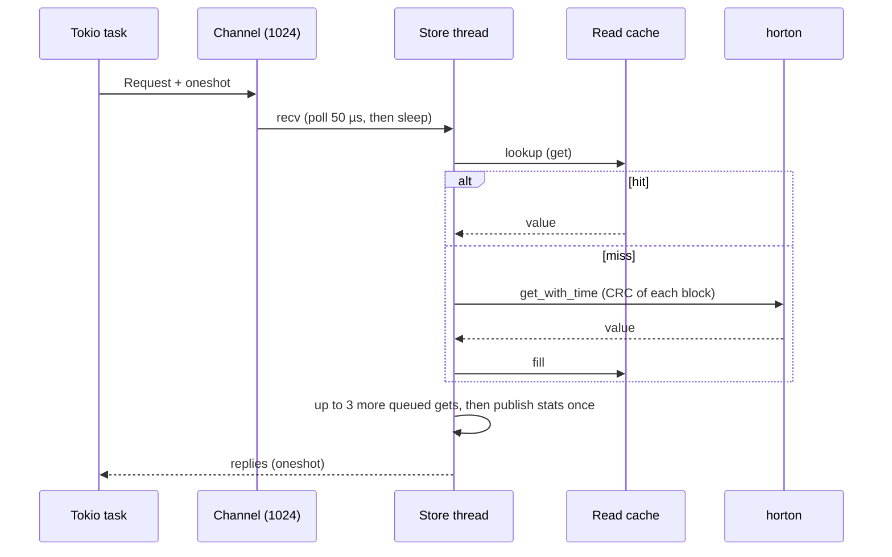

# Performance audit: the hot path

This file records an audit of the read and write paths, the changes it
made, and the work that is left. The benchmark is
`benches/throughput.rs`. Run it with:

```sh
cargo bench --bench throughput
```

Each benchmark runs 1, 16 or 128 callers on a Tokio runtime with four
workers. One iteration is one call. The store is 256 MiB with `sync =
false`, except `put_sync`. Values are 100 bytes. The key space is 20,000
keys.

| Benchmark | What it measures |
|---|---|
| `put`, `put_sync` | `Horton::put` over the key space, without and with `fdatasync` |
| `get_memtable` | `get` of 2,000 keys that are in the memtable, read cache off |
| `get_table` | `get` of 20,000 keys after `compact`, read cache off |
| `get_cached` | the `get_table` keys through a warm read cache (default size): each key read in two clock seconds first, so each key is hot |
| `get_churn` | the `get_table` keys through a 1 MiB read cache, which holds about a fifth of them: most gets miss and evict |
| `scan_100` | `scan` of 100 entries from a random key |

## How a call travels



## What the profiles showed

`perf` on the store thread, before the changes:

| Path | Where the time went |
|---|---|
| Table get | 41 % of all samples in `horton::sstable::check_block_crc`. horton checks the CRC of each 16 KiB block a get reads (footer, bloom, index, data), also on a block-cache hit. About 64 KiB of CRC for each table a get looks at. |
| Memtable get | About 35 % of the store thread in kernel wake-ups (`_raw_spin_unlock_irqrestore`): each reply woke a parked runtime thread. 9 % in `MemTable::max_covering_rdel`, which scans all 4,096 memtable slots on each get. A 4 KiB `calloc` on each get. |
| One caller | 44 µs for each round trip, almost all thread sleep and wake-up on both sides. |
| Stats | `publish` ran two times for each request, and each time built a new `Stats` with a new `Vec`. |
| Scan | 42 % in the CRC check again. The 44 KiB scan object is not a cost. |

## Changes

| Change | Effect |
|---|---|
| Read cache (ADR 0006) | A repeat get does not read horton, so it skips the CRC checks. |
| Read batches of 4 | One stats publish and one burst of replies for up to four gets. Batches of 8, 16 and 256 were slower at 16 callers: the callers wait for the whole batch. |
| Poll 50 µs before sleep | A caller that sends again at once finds the store thread awake. At most half the CPUs poll at the same time, over all stores of the process. Not on a one-CPU machine. |
| Publish once, in place | No allocation and one mutex lock for each request. |
| Reused value buffer | No 4 KiB `calloc` per get. A returned value has the capacity of its length. |
| Writes update only cached keys | A write costs one hash lookup per op in the cache. Keys that the app writes but does not read take no space. The update runs before the stats publish, so the stats match each reply. |
| Hot keys last | A key that misses in two clock seconds is also read at clock `FAR`. A value live there holds until a write, so a hot key costs two horton reads one time. |

## Results

The mean of two interleaved runs of each build on one 4-CPU VM, Rust
1.100, release profile. "Before" is commit `00349c6`, with the same
benchmark file; it has no read cache, so its `get_cached` and `get_churn`
are the same path as `get_table`. `put_sync` depends on the disk's
`fdatasync` time and moves by up to 30 % between runs. `get_churn`
moves with the keys that eviction keeps, so the table shows its range.

| Benchmark | Before (calls/s) | After (calls/s) | Change |
|---|--:|--:|--:|
| `put/1` | 21,008 | 28,969 | +38 % |
| `put/16` | 183,335 | 180,880 | −1 % |
| `put/128` | 278,165 | 279,850 | +1 % |
| `put_sync/1` | 4,827 | 5,734 | +19 % |
| `put_sync/16` | 39,000 | 41,757 | +7 % |
| `put_sync/128` | 141,745 | 141,735 | 0 % |
| `get_memtable/1` | 23,823 | 54,444 | 2.3× |
| `get_memtable/16` | 220,495 | 396,760 | +80 % |
| `get_memtable/128` | 223,375 | 407,550 | +82 % |
| `get_table/1` | 9,290 | 10,711 | +15 % |
| `get_table/16` | 13,129 | 15,248 | +16 % |
| `get_table/128` | 13,280 | 15,196 | +14 % |
| `get_cached/1` | 9,225 | 64,859 | 7.0× |
| `get_cached/16` | 13,316 | 615,400 | 46.2× |
| `get_cached/128` | 13,630 | 816,365 | 59.9× |
| `get_churn/1` | 9,206 | 35,259 (23,353–47,165) | 3.8× |
| `get_churn/16` | 13,162 | 22,430 (20,340–24,520) | +70 % |
| `get_churn/128` | 13,474 | 29,220 (18,570–39,871) | 2.2× |
| `scan_100/1` | 3,354 | 3,467 | +3 % |
| `scan_100/16` | 4,420 | 4,380 | −1 % |

What the numbers say:

- **Hot reads** gain the most: a get that the read cache answers is 7 to
  60 times faster than a table get before.
- **Reads that miss** the cache are not slower: `get_table` (cache off)
  gains 13 to 16 % from the cheaper store-thread loop, and `get_churn`
  (most gets miss and evict) is at or above the old table get.
- **Memtable reads** are about twice as fast: fewer wake-ups and one
  stats publish for each read batch.
- **One caller in a loop** gains 40 % on puts and 2.3 times on gets: the
  short poll removes a sleep and a wake-up from each call.
- **Writes under load** are the same as before. A write group is still
  one WAL block and one `fdatasync` (horton's limit, below).
- **Scans** are the same. horton's CRC checks set their cost.

## Work that is left: horton

These costs are inside horton 0.18. The plugin cannot change them.

1. **CRC on a cache hit.** `read_block_cached` returns the raw image, and
   every caller checks its CRC again. A block cache that holds only
   checked blocks could skip the check on a hit. With a slicing-by-8 CRC
   over 16 KiB, this is most of a table get.
2. **A faster CRC.** `crc32` is a table-driven slicing-by-8 loop. A
   carry-less multiply (PCLMULQDQ, ARMv8 PMULL) version is several times
   faster on the same polynomial.
3. **`max_covering_rdel`** scans every memtable slot on each get, also
   when the memtable holds no range delete. A count of range deletes, or
   a separate list, makes the common case free.
4. **Group commit across WAL blocks.** One write batch must fit one 16 KiB
   WAL block, so one `fdatasync` covers at most about 120 puts of 100
   bytes. horton could let one sync cover more than one block.

## Work that is left: the plugin

- Gets still pass through the store thread. Reads that do not touch the
  store thread would need a `Sync` read path in horton.
- A `get_many` call would put many keys in one request and one reply.
