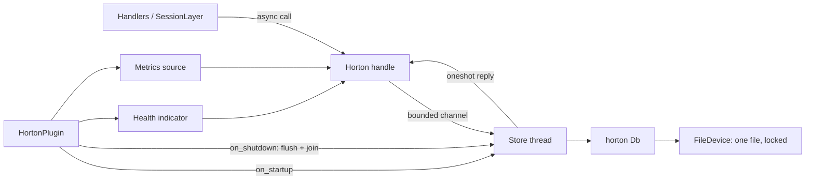

# Plan: autumn-plugin-horton v0.1

This plan records the planning methods and their results. The methods are
brainstorming, reverse brainstorming and six thinking hats. The acceptance
criteria (AC) are in [issue #1](https://github.com/autumn-foundation/autumn-plugin-horton/issues/1).

## Goal

Give an Autumn 0.8 app a durable, embedded key-value store with no external
service. The store is [horton](https://github.com/madmax983/horton).

## 1. Brainstorming

We wrote down all ideas first. We did not judge them during this step.

| # | Idea | Decision |
|---|---|---|
| B1 | An async `Horton` handle in `AppState`: get, put, delete, range delete, TTL, batch, scan, flush, compact, stats | v0.1 |
| B2 | A session store, so sessions stay after a restart without Redis | v0.1 |
| B3 | A cache backend (`autumn_web::cache::Cache`) | Rejected for v0.1. See ADR 0002 |
| B4 | An idempotency store | Later |
| B5 | A health indicator for `/actuator/health` | v0.1 |
| B6 | Prometheus metrics | v0.1 |
| B7 | Configuration from `autumn.toml`, profiles and environment variables | v0.1 |
| B8 | Clean shutdown: flush, then stop the store thread | v0.1 |
| B9 | Admin routes (`/horton/stats`) | Rejected. The actuator shows the same data. No routes means a smaller attack surface |
| B10 | Archive cold tables to object storage (horton archive API) | Later |
| B11 | A capability provider for sandboxed plugins | Later |
| B12 | A scheduled compaction job | Rejected. The store thread compacts when it is idle |
| B13 | Expiry of old data with no caller action | v0.1 (part of B1 and B2) |

## 2. Reverse brainstorming

We asked: "How can we make this plugin fail?" Each answer gives a
mitigation. Each mitigation has a test or a proof.

| # | How to make it fail | Mitigation | Evidence |
|---|---|---|---|
| R1 | Do disk I/O on a Tokio worker thread | One dedicated store thread owns the database. Callers wait on a oneshot channel | `store` tests on a current-thread runtime |
| R2 | Lose a write that returned `Ok` | Reply only after the WAL commit and `fdatasync` | Reopen test |
| R3 | Open one file from two processes | Take an exclusive OS file lock. A second open fails | Lock test |
| R4 | Change the file size after creation | Keep the size of an existing file. Log a warning if the config differs | Reopen-with-new-size test |
| R5 | Overflow the stack when the database is built | Build it on a store thread with a 64 MiB stack, then box it | Every test opens a store |
| R6 | Let app keys and session keys collide | Byte `0x00` starts every internal key. The app API refuses such keys and scans skip them | Unit tests and Verus proof |
| R7 | Accept a value that is too large | Return a typed error that names the limit | Unit tests |
| R8 | Let the request queue grow with no limit | Use a bounded channel. Senders wait when it is full | Code review |
| R9 | Lose the memtable at shutdown | The WAL already holds it. Shutdown also flushes and joins the thread | Shutdown test |
| R10 | Hang callers after the store thread stops | Calls return `HortonError::Closed`. Health shows `DOWN` | Closed-store tests |
| R11 | Make a TTL of zero mean "never expires" | A TTL always gives an expiry tick of at least 1 | Verus proof and unit test |
| R12 | Let the clock go backwards and break the purge rule | The store clock is monotonic: `max(last, wall)` | Verus proof and unit test |
| R13 | Keep expired sessions on disk forever | Compaction purges entries that expired before the store clock | Expiry test |
| R14 | Ignore a typo in the config | Unknown keys under `[horton]` fail startup | Config test |
| R15 | Break on Windows | Positioned I/O has `cfg(unix)` and `cfg(windows)` halves. CI runs on Linux, macOS and Windows | CI matrix |
| R16 | Drift from the Autumn API | `contract()` declares `autumn_web = "0.8"` | Contract test |

## 3. Six thinking hats

**White hat (facts).**
- Autumn 0.8 plugins implement `Plugin::build` and can add startup hooks, shutdown hooks, health indicators, metrics sources and a session store.
- `with_extension` values do not reach run time. A startup hook must call `AppState::insert_extension`.
- horton is `no_std` and has no allocator. Its futures are not `Send`. Writes need `&mut Db`. Sizes are fixed at compile time.
- horton's host `FileDevice` and `Store` are example code, not library API. The plugin must contain its own copy.

**Red hat (feelings).**
- Users want "SQLite for key-value": one file and no server.
- Users fear data loss in a new storage engine.

**Black hat (risks).**
- horton is before 1.0. A new minor version can change the on-disk format. It refuses old files and never misreads them. We pin the minor version and document this.
- Only one process can open a store. There is no replication.
- Keys are at most 128 bytes and values at most 4096 bytes.

**Yellow hat (benefits).**
- No external service and a small memory footprint.
- Sessions stay after a restart.
- horton has power-cut tests, and its host store runs in CI on three operating systems.

**Green hat (new ideas).**
- Tier cold data to S3 with `autumn-storage-s3` and the horton archive API.
- A cache backend once Autumn has an async cache trait.

**Blue hat (process).**
- Plan, then write the issue and its AC.
- Write a Verus spec and proof for each critical invariant: TTL expiry, the monotonic clock, key namespaces and group-commit fit.
- For each feature: a failing test (RED), the smallest working code (GREEN), then a refactor with all tests and proofs green.
- CI: fmt, clippy (pedantic and nursery), tests on three operating systems, docs, coverage of at least 85 %, MSRV and Verus.
- Review with agents from several angles. Stop after 2 or 3 rounds.
- Give evidence for each AC.

## 4. Design

Modules:

| Module | Job |
|---|---|
| `config` | `[horton]` settings, layered: defaults, builder, `autumn.toml`, profile, environment |
| `device` | `FileDevice`: positioned I/O, `fdatasync`, exclusive lock |
| `engine` | The store thread: group commit, room making, background compaction, TTL clock |
| `handle` | `Horton`: the cloneable async API |
| `keys` | Key namespaces (pure, proved) |
| `ttl` | Expiry and clock arithmetic (pure, proved) |
| `session` | `HortonSessionStore` |
| `health`, `metrics` | Actuator integration |
| `plugin` | `HortonPlugin` |
